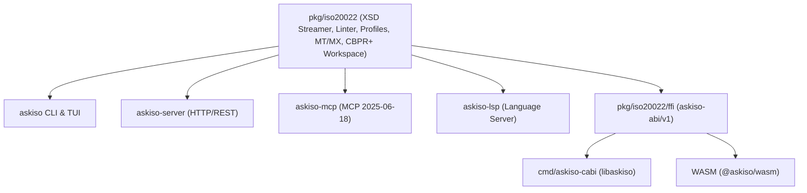

# AskISO Architecture

AskISO is built around a single deterministic Go core (`pkg/iso20022`) shared across every delivery surface so that an ISO 20022 message validated in a developer's editor, an AI assistant, a browser sandbox, or a clearing pipeline produces the exact same verdict.

## Design Principles

1. **Zero Redistribution:** AskISO embeds only factual metadata (message IDs, sets, RA URLs). Users supply their own downloaded ISO 20022 catalogue or private CBPR+ artefacts.
2. **Three-Tier Validation:** Syntactic XSD streaming (`O(1)` per repeating transaction below `StreamDepth = 2`), semantic business rules (IBAN/BIC/UETR/currency), and dated scheme profiles (`cbpr-2026`, etc.).
3. **Polyglot Parity via `askiso-abi/v1`:** All language SDKs bind to the compiled Go core through WASM or C-ABI (`-buildmode=c-shared`), eliminating rule drift across runtimes.
