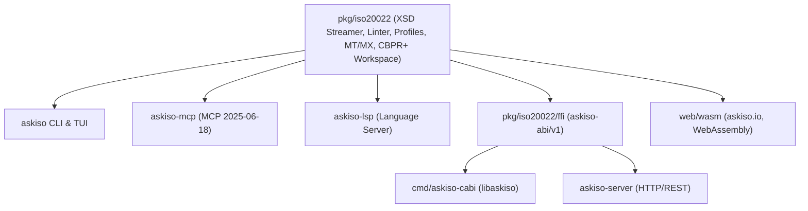

# AskISO Architecture

AskISO is built around a single deterministic Go core (`pkg/iso20022`) shared across every delivery surface so that an ISO 20022 message validated in a developer's editor, an AI assistant, a browser sandbox, or a clearing pipeline produces the exact same verdict.

## Design Principles

1. **Zero Redistribution:** AskISO embeds only factual metadata (message IDs, sets, RA URLs). Users supply their own downloaded ISO 20022 catalogue or private CBPR+ artefacts.
2. **Three-Tier Validation:** Syntactic XSD streaming (`O(1)` per repeating transaction below `StreamDepth = 2`), semantic business rules (IBAN/BIC/UETR/currency), and dated scheme profiles (`cbpr-2026`, etc.).
3. **One Engine for Every Runtime:** the browser runs `pkg/iso20022` compiled to WebAssembly, and other languages reach it through the `askiso-abi/v1` JSON contract, either in-process via the C-ABI library (`-buildmode=c-shared`) or over HTTP via `askiso-server`. No language packages are published yet.
